# EventPipe

[](https://github.com/sayomiyori/EventPipe/actions)
[](#)
[](#)
[](#)
[](#)
[](#)
[](#)
[](#)
[](#)
[](#)

Microservice ETL pipeline: **Ingest (REST + gRPC) → Kafka → Transform (validate/enrich/normalize) → PostgreSQL + SeaweedFS (S3-compatible, Apache 2.0)**, with Query API, Dead Letter Queue, Prometheus/Grafana monitoring, Docker Compose, and Kubernetes manifests.

## Current verification

On 2026-10-09, all 27 tests passed with real Kafka, PostgreSQL and SeaweedFS S3;
full Ruff checks and independent review passed. CI now reuses the test Compose
and rejects skipped tests. [Run 37894123954](https://github.com/sayomiyori/EventPipe/actions/runs/37894123954)
passed all tests and three Docker builds. The rebuilt local stack passed the
complete REST/batch/gRPC-to-query smoke twice, including duplicate identity,
raw S3 download, independent public-host SigV4 verification and real Kafka DLQ.
The earlier local execution blockers are resolved for these checks.
Historical screenshots and checks below do not replace current runtime evidence.

The local hardening source adds opt-in online AuthFortress authorization and
tenant scope for REST/gRPC admission, Kafka/raw storage, PostgreSQL and Query.
Legacy NULL records remain standalone. See `specs/local-hardening.md` and the
explicit schema procedure below. Public deployment and NexusCore runtime
integration remain separate; source verification does not activate the platform.

Application and migration images run as UID 10001. Protobuf generation and package
installation happen during the build; runtime records remain in PostgreSQL/S3.

## Architecture

```
┌──────────────────┐     ┌────────────────┐     ┌─────────────────┐
│ Ingest Service   │────▶│ Apache Kafka   │────▶│ Transform       │
│ FastAPI          │     │ events.raw     │     │ Service         │
│ REST + gRPC      │     │ events.dlq     │     │ validate →      │
└──────────────────┘     └────────────────┘     │ enrich →        │
                                                │ normalize       │
                                                └────┬───────┬────┘
                                                     │       │
                                                     ▼       ▼
                                              ┌──────────┐ ┌────────┐
                                              │PostgreSQL│ │ S3     │
                                              │(results) │ │ (S3)   │
                                              └──────────┘ └────────┘

┌──────────────────┐     ┌─────────────┐
│ Query Service    │     │ Prometheus  │
│ FastAPI          │     │ + Grafana   │
│ REST             │     └─────────────┘
└──────────────────┘
```

## Screenshots

### Docker Compose — all services running
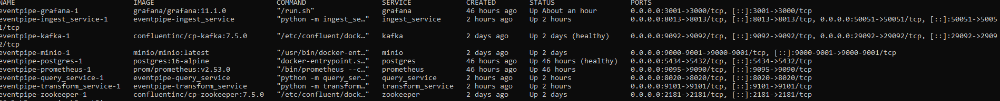

### Ingest API (Swagger)
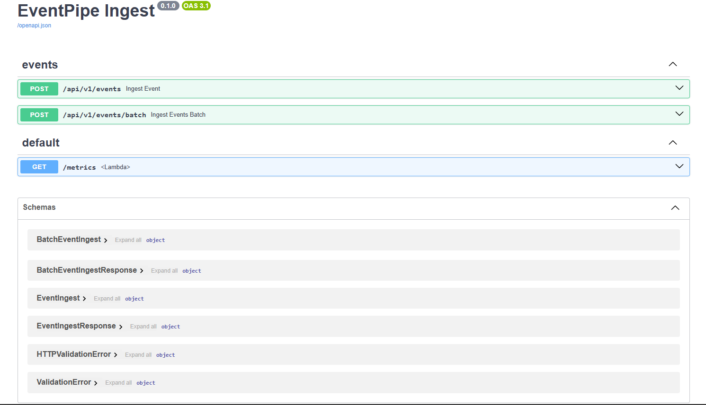

### Query API (Swagger)
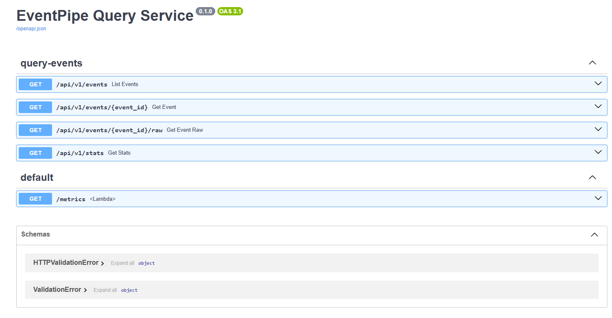

### Kafka Consumer — events.raw messages
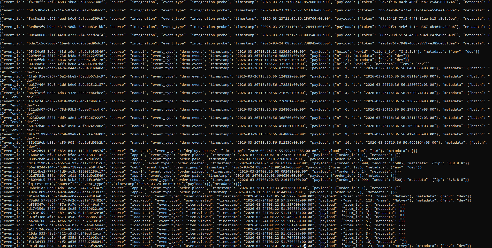

### Transform Service logs
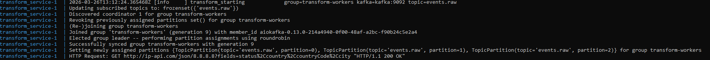

### PostgreSQL — processed events
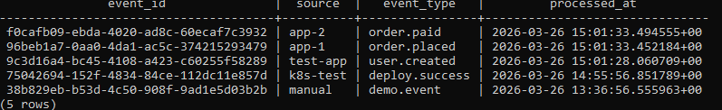

### Historical MinIO screenshot (current Compose uses SeaweedFS)
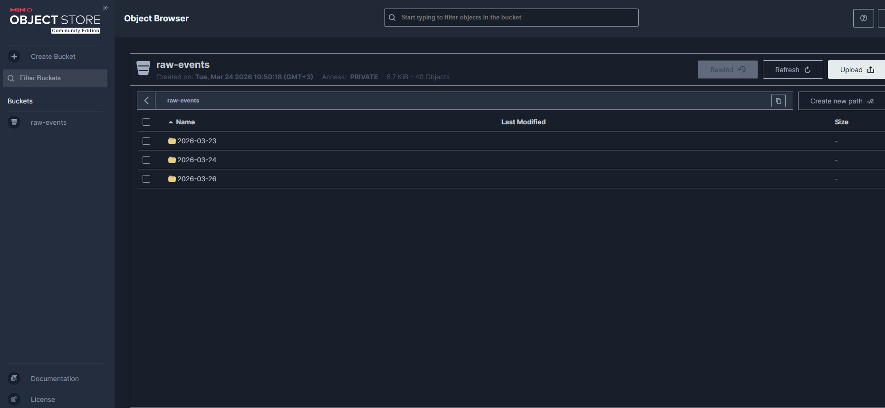

### Query Stats response
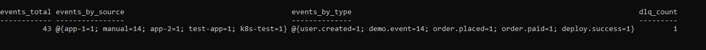

### Prometheus Metrics
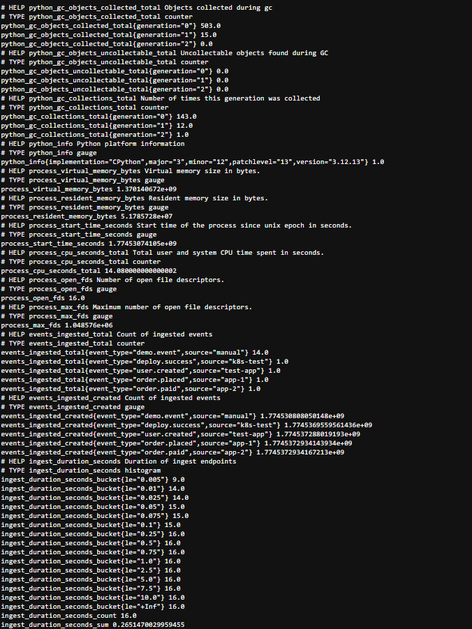

### Grafana Dashboard
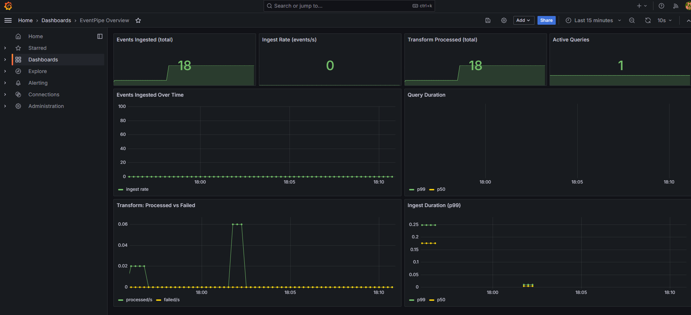

### Kubernetes — pods running
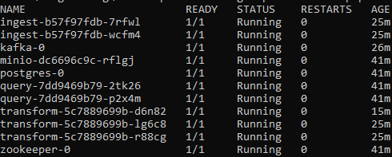

### Kubernetes — scaled Transform deployment
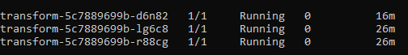

## Tech Stack

| Component | Technology |
|-----------|-----------|
| Ingest API | FastAPI (asyncio) + gRPC (grpcio, protobuf) |
| Message broker | Apache Kafka (aiokafka), 3 partitions |
| Transform | Python consumer, pipeline: validate → enrich → normalize |
| Storage (processed) | PostgreSQL 16, SQLAlchemy 2 (asyncpg) |
| Storage (raw) | SeaweedFS (S3-compatible), bucket `raw-events` |
| Dead Letter Queue | Kafka topic `events.dlq` |
| Metrics | Prometheus + Grafana |
| Deployment | Docker Compose, Kubernetes (Minikube) |
| CI | GitHub Actions (ruff + pytest) |

## Architecture Decisions

**Kafka over RabbitMQ** — EventPipe processes high-throughput event streams where ordering matters. Kafka's partitioned log with consumer groups gives replay capability and natural parallelism — Transform workers scale by partition count.

**S3-compatible raw storage, PostgreSQL for processed** — raw events are immutable blobs (write-once, read-rarely) → S3-compatible storage. Processed events need filtering, aggregation, joins → relational DB with JSONB.

**Separate Ingest / Transform / Query services** — each has a different scaling profile: Ingest is CPU-light I/O-bound, Transform is CPU-heavy, Query is read-heavy. Independent scaling without affecting other services.

**Dead Letter Queue as separate Kafka topic** — failed events don't block the main pipeline. DLQ enables manual inspection and replay without data loss.

**gRPC alongside REST** — high-throughput internal clients use gRPC (binary, streaming); external clients use REST. Both share the same Kafka producer — no code duplication.

## Quick Start

```bash
# Validate configuration without printing secrets; prepare infrastructure first.
docker compose config --quiet
docker compose up -d postgres kafka-init seaweedfs
# Fresh database only: an unexpected existing schema fails closed.
docker compose --profile tools run --rm --build migrate
# Start applications only after migration succeeds.
docker compose up -d --build ingest_service transform_service query_service
# Optional local monitoring.
docker compose up -d prometheus grafana
```

For a previous unversioned database, first stop ingest/transform/query, create a
backup and rehearse restoration. Then explicitly run
`docker compose --profile tools run --rm --build migrate python -m scripts.adopt_legacy_schema`.
The adoption tool accepts only the exact known legacy schema, writes its baseline
revision and preserves rows. Unexpected columns, constraints, indexes, objects or
an existing revision are rejected. Never use a blind Alembic stamp to bypass this
check. Next run `docker compose --profile tools run --rm migrate` and restart the
applications. Forward revision `002_tenant_boundary` adds nullable tenant scope
and durable tenant failure diagnostics; historical rows remain unassigned. Downgrades remove new
scope/state and are for disposable rehearsals only.

To enable tenant mode, set all three of `EVENTPIPE_PLATFORM_MODE`,
`TRANSFORM_PLATFORM_MODE` and `QUERY_PLATFORM_MODE` to true, with fixed
`EVENTPIPE_AUTH_URL` and `QUERY_AUTH_URL` pointing to AuthFortress. REST requires
`Authorization: Bearer ...` and `X-Tenant-ID`; gRPC uses `authorization` and
`x-tenant-id` metadata. Every tenant selector is verified online: reads use
`tenant.read`, admission uses `tenant.manage`; no positive auth cache exists.
Invalid/revoked identity is 401, foreign membership 404, insufficient permission
403 and identity outage 503 (corresponding gRPC statuses). Platform raw access is
an authenticated proxy; no unscoped presigned raw URL is issued. Operational
process metrics remain unscoped on loopback; they are not tenant usage APIs.
Standalone mode preserves the legacy API.

Geo-IP enrichment defaults off (`TRANSFORM_GEO_IP_ENABLED=false`) to avoid an
implicit third-party call. Invalid-event diagnostics contain static validation
codes instead of raw input. PostgreSQL/S3 failures leave the source Kafka offset
uncommitted; restart replays that event. A lost acknowledgement can still cause
duplicate effects; no exactly-once guarantee is made. Infrastructure ports bind
to loopback; Kafka/S3 credentials remain a trusted local boundary. Do not expose
the default Compose credentials or enable real external traffic as part of this
local verification procedure.

Default credentials:
- **SeaweedFS S3**: `http://localhost:8333`; master status: `http://localhost:9333/cluster/status`. There is no MinIO console in this Compose profile.
- **Grafana**: `http://localhost:3001` — `admin` / `admin`
- **Prometheus**: `http://localhost:9095`

## API

### Ingest Service (`http://localhost:8013`)

#### `POST /api/v1/events`

Ingest a single event.

```json
// Request
{
  "source": "payment-service",
  "event_type": "order.created",
  "payload": {"order_id": 42, "amount": 1500},
  "metadata": {"env": "production"}
}

// Response 200
{
  "event_id": "a1b2c3d4-...",
  "status": "accepted"
}
```

#### `POST /api/v1/events/batch`

Ingest multiple events.

```json
// Request
{
  "events": [
    {"source": "app-1", "event_type": "user.created", "payload": {"user_id": 1}, "metadata": {}},
    {"source": "app-2", "event_type": "order.paid", "payload": {"order_id": 2}, "metadata": {}}
  ]
}
```

#### `GET /metrics`

Prometheus metrics (text/plain).

#### `GET /health`

Health check.

---

### Query Service (`http://localhost:8020`)

#### `GET /api/v1/events`

List processed events with filters.

| Parameter | Description |
|-----------|-------------|
| `source` | Filter by source |
| `event_type` | Filter by event type |
| `from` | Start datetime |
| `to` | End datetime |
| `page` | Page number (default: 1) |
| `size` | Page size (default: 20) |

#### `GET /api/v1/events/{event_id}`

Full event details: payload, metadata, enrichments, s3_key.

#### `GET /api/v1/events/{event_id}/raw`

Redirect (307) to a pre-signed S3 URL (15 min expiry). Downloads the raw JSON event file.

#### `GET /api/v1/stats`

Aggregated statistics.

```json
{
  "events_total": 1500,
  "events_by_source": {"payment-service": 800, "user-service": 700},
  "events_by_type": {"order.created": 500, "user.created": 400, ...},
  "dlq_count": 3
}
```

#### `GET /metrics`

Prometheus metrics (text/plain).

#### `GET /health`

Health check.

## Prometheus Metrics

### Ingest Service

| Metric | Type | Description |
|--------|------|-------------|
| `events_ingested_total` | Counter | Ingested events; labels: `source`, `event_type` |
| `ingest_duration_seconds` | Histogram | Ingest request latency |

### Transform Service

| Metric | Type | Description |
|--------|------|-------------|
| `events_processed_total` | Counter | Successfully processed events |
| `events_failed_total` | Counter | Events sent to DLQ |
| `transform_duration_seconds` | Histogram | Full pipeline latency |
| `kafka_consumer_lag` | Gauge | Consumer group lag |
| `s3_upload_duration_seconds` | Histogram | S3 upload latency |

### Query Service

| Metric | Type | Description |
|--------|------|-------------|
| `query_duration_seconds` | Histogram | Query request latency |
| `active_queries` | Gauge | Currently executing queries |

## Running Tests

```bash
# Install dependencies
pip install -r ingest_service/requirements.txt
pip install -r transform_service/requirements.txt
pip install -r query_service/requirements.txt

# Generate protobuf
make proto

# Run tests (non-integration)
make test
# or
PYTHONPATH=. python -m pytest -m "not integration" -v
```

## Kubernetes (Minikube)

### Prerequisites

- `kubectl`
- `minikube`

### Deploy

```bash
# 1. Start Minikube
minikube start --memory=4096

# 2. Build images inside Minikube's Docker daemon
eval "$(minikube docker-env)"    # bash
# or: & minikube -p minikube docker-env --shell powershell | Invoke-Expression  # PowerShell

docker build -f ingest_service/Dockerfile -t eventpipe-ingest:latest .
docker build -f transform_service/Dockerfile -t eventpipe-transform:latest .
docker build -f query_service/Dockerfile -t eventpipe-query:latest .

# 3. Enable Ingress
minikube addons enable ingress

# 4. Apply manifests
kubectl apply -f k8s/namespace.yaml
kubectl apply -f k8s/ --recursive
kubectl get pods -n eventpipe

# 5. Access Ingest Service
minikube service ingest-service -n eventpipe
```

### Scaling

```bash
kubectl scale deployment transform --replicas=4 -n eventpipe
kubectl get pods -n eventpipe
```

## Project Structure

```
eventpipe/
├── proto/                    # Protobuf schema
├── ingest_service/           # REST + gRPC → Kafka producer
├── transform_service/        # Kafka consumer → pipeline → PG + S3
├── query_service/            # REST API for reading processed events
├── monitoring/               # Prometheus + Grafana configs
├── k8s/                      # Kubernetes manifests
├── docs/images/              # Screenshots
├── docker-compose.yml
├── Makefile
└── pyproject.toml
```
